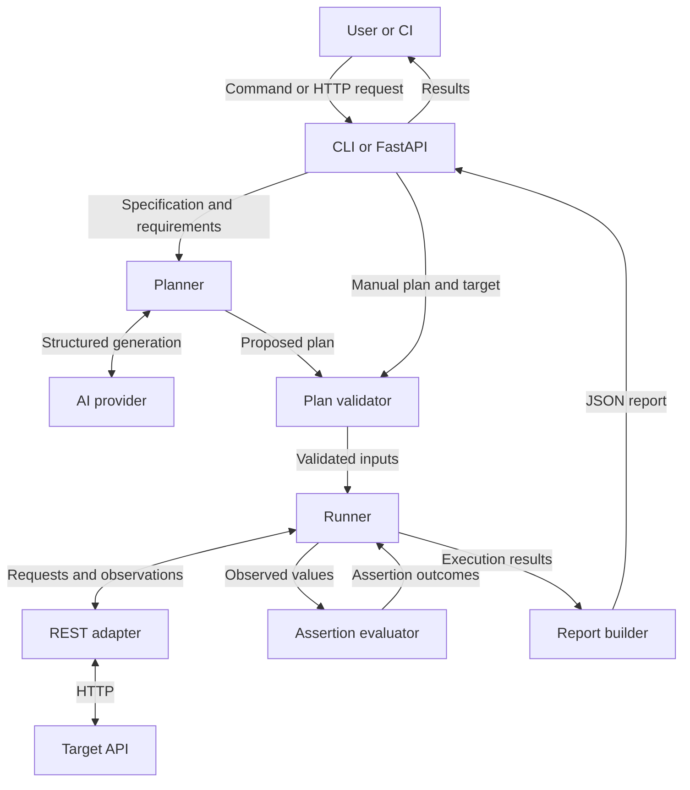

# MVP Architecture and Test-Plan Format

Status: Proposed
Related issue: #2
MVP target: 22 November 2026

## 1. Design Goals

- Execute structured REST API tests reliably.
- Separate AI planning from execution.
- Verify responses and business outcomes.
- Link results to requirements.
- Run locally and in continuous integration.
- Keep components small enough to test independently.

## 2. Deployment Scope

The MVP consists of one Python testing service and one demonstration API.

The testing service exposes an HTTP API and a command-line interface.
Both use the same application components.

Execution is synchronous and sequential in the MVP.
Queues, execution workers, databases, and dashboards are deferred.

Plans, target configuration, and reports use JSON files.

## 3. Components and Communication



Generating a plan returns it for inspection. Generation does not
automatically start execution.

### Responsibilities

| Component | Responsibility |
|---|---|
| CLI and FastAPI | Accept inputs and return results |
| Planner | Generate proposed plans from supplied requirements and specification |
| Plan validator | Validate structure, references, supported capabilities, and target restrictions |
| Runner | Execute setup, test steps, and cleanup in order |
| REST adapter | Send HTTP requests with configured timeouts and return observations |
| Assertion evaluator | Compare observations with explicit expectations |
| Report builder | Produce sanitised, traceable results |

The runner does not ask AI whether a test passed.
The assertion evaluator makes that decision.

## 4. Suggested Source Structure

```text
src/ai_test_service/
    api.py
    cli.py
    models.py
    validation.py
    runner.py
    assertions.py
    reporting.py
    adapters/
        rest.py
    planning/
        base.py
        example.py
        ai.py

demo_target/
    app.py

examples/
    target.json
    underage-registration.plan.json

tests/
```

These are modules inside one application, not separate microservices.

## 5. Service Interface

| Endpoint | Behaviour |
|---|---|
| GET /health | Return service health |
| POST /plans/generate | Accept specification and requirements; return a validated proposal or errors |
| POST /runs | Accept target configuration and plan; execute synchronously and return a report |

A completed test run returns HTTP 200 even when assertions fail.
The report communicates the test outcome.

Invalid input returns HTTP 422 before execution.
Unexpected service failures return HTTP 500.

The MVP does not provide background jobs or polling endpoints.

### Planned CLI

```text
ai-test-service run --target examples/target.json --plan examples/underage-registration.plan.json --report reports/run.json
```

| Exit code | Meaning |
|---|---|
| 0 | Successful run |
| 1 | Failed assertions, execution errors, skipped required steps, or cleanup failure |
| 2 | Invalid input or inability to produce the requested report |

## 6. Target Configuration

| Field | Type | Meaning |
|---|---|---|
| schema_version | string | Configuration format version; initially "1.0" |
| target_id | string | Stable target identifier |
| base_url | string | Permitted HTTP or HTTPS origin |
| timeout_seconds | number | Positive per-request timeout |
| max_steps | integer | Maximum total setup, test, and cleanup steps |
| auth | object or null | Optional credential reference |

For the MVP, base_url contains only scheme, host, and optional port.
Paths, query strings, embedded credentials, and fragments are rejected.

Optional bearer authentication uses:

```json
{
  "type": "bearer",
  "token_env": "DEMO_API_TOKEN"
}
```

The runner reads the environment variable during execution.
The actual token is never stored in plans or reports or sent to the planner.

## 7. Plan Structure

A plan represents one scenario.

| Field | Type | Meaning |
|---|---|---|
| schema_version | string | Plan format version; initially "1.0" |
| plan_id | string | Unique scenario identifier |
| name | string | Human-readable scenario name |
| requirement_ids | array of strings | Requirements covered by the scenario |
| variables | object | Scenario values, including generated values |
| setup | array | Preparation steps |
| steps | array | Test and verification steps |
| cleanup | array | Cleanup steps attempted after execution |

Unknown fields and unsupported format versions are rejected.

### Step Structure

| Field | Type | Meaning |
|---|---|---|
| id | string | Unique across all phases |
| request | object | HTTP method, relative path, optional query parameters, and optional JSON body |
| capture | object | Optional mapping of variable names to JSON Pointers |
| assertions | array | Explicit checks on this response |

Initially supported methods: GET, POST, DELETE.

A request path must start with exactly one slash.
Absolute URLs, fragments, backslashes, and parent-directory path segments
are rejected. Query parameters belong in `params`, not `path`.

Redirects are disabled.
The adapter verifies the resolved destination before sending a request.

### Variable References

The format `${variable_name}` references an existing variable.

References may appear in request paths, parameter values, and JSON values.
An entire JSON value reference preserves the original value type.
Embedded references produce strings.

Capture names cannot overwrite existing variables.
A capture can be used only by later steps.

### Generated Values

A variable can contain a generator declaration:

```json
{
  "generator": "uuid4"
}
```

The runner resolves it once at the beginning of the run.

The report records non-sensitive resolved values so the test data can be
inspected and reused. Repeated runs may generate different identifiers.

### Capturing Response Values

Captures use JSON Pointer syntax:

```json
{
  "capture": {
    "created_user_id": "/id"
  }
}
```

An empty pointer selects the whole JSON document.

A missing pointer or non-JSON response causes a capture error.
Steps that require an unavailable captured value are skipped and reported.
Cleanup steps that can still resolve their inputs are attempted.

## 8. Supported Assertions

### Response Status

```json
{
  "type": "status_code",
  "equals": 422,
  "requirement_id": "DEMO-01"
}
```

### JSON Value Equality

```json
{
  "type": "json_equals",
  "pointer": "/items",
  "equals": [],
  "requirement_id": "DEMO-04"
}
```

JSON equality distinguishes null, missing values, booleans, numbers,
strings, arrays, and objects. Object key order does not matter.

A missing JSON Pointer fails the assertion.
A non-JSON response fails a JSON assertion.

Every assertion references a requirement listed in the plan.
AI-generated references must also resolve to supplied requirements.

## 9. Execution Behaviour

1. Validate the target and complete plan before any target request.
2. Resolve generated variables.
3. Execute setup sequentially.
4. If setup fails, skip the main test steps.
5. Otherwise execute test steps sequentially.
6. Evaluate all possible assertions after each response.
7. Continue independent steps after assertion failures.
8. Skip steps whose inputs cannot be resolved.
9. Attempt all resolvable cleanup steps, even after failure.
10. Produce the report.

Requests are not automatically retried.
A timeout does not prove that the target operation had no effect.

The runner checks the total step count against max_steps.
Concurrent runs against shared demonstration data are outside MVP scope.

## 10. Result Model

### Assertion Outcomes

- passed: observed value matches the expectation.
- failed: an evaluable observation does not match the expectation.

### Step Outcomes

- passed: request, captures, and assertions completed successfully.
- failed: one or more assertions failed.
- error: request execution or required capture failed.
- skipped: prerequisites were not available.

The report preserves individual assertion and error details even if
several problems occur in the same step.

### Run Outcomes

- passed: all required steps and cleanup completed successfully.
- failed: at least one assertion failed, with no execution or cleanup errors.
- error: execution, dependency, or cleanup problems prevented a complete successful run.

An error outcome must not hide assertion failures already observed.

### Report Fields

| Field | Meaning |
|---|---|
| schema_version | Report format version |
| run_id | Unique execution identifier |
| plan_id | Executed scenario |
| target_id | Configured target |
| started_at / finished_at | UTC timestamps |
| status | Overall run outcome |
| resolved_variables | Non-sensitive test data values |
| summary | Counts of assertion and step outcomes |
| step_results | Phase, request evidence, status, timings, captures, assertions, and errors |

Each assertion result includes:
- Requirement identifier.
- Assertion type.
- Expected and observed values.
- Outcome and explanation.

Evidence is sanitised before persistence.
Authentication headers are omitted.
Sensitive payload fields are redacted.

The MVP uses synthetic demonstration data.

## 11. AI Planning Boundary

The planner receives:
- Supported API specification content.
- Identified business requirements.
- Supported plan schema and capabilities.

The planner does not receive execution credentials.

Generated plans must pass the same validation as manual plans.
Missing expected behaviour is returned as an unresolved item.
A proposal with unresolved expectations cannot be executed as a complete plan.

The example planner returns predefined scenarios and is clearly labelled.
It does not claim to use a live AI provider.

## 12. Demonstration API Contract

| Operation | Expected behaviour |
|---|---|
| POST /users | Create a valid user; return 201 and an object containing id, email, and age |
| POST /users with age below 18 | Return 422 without saving a user |
| POST /users with a duplicate email | Return 409 without creating another user |
| POST /users with missing email or age | Return 422 without saving a user |
| GET /users?email=... | Return 200 with {"items": [...]} containing exact email matches |
| DELETE /test-support/users?email=... | Delete matching test users; return 204 even if none exist |

The cleanup operation exists only in the local demonstration application.
It is not an assumption about arbitrary target APIs.

The demo uses in-memory storage, cleared when the application restarts.

## 13. Completion Checklist for Issue #2

- [ ] Components and communication documented.
- [ ] HTTP and CLI entry points defined.
- [ ] Target configuration defined.
- [ ] Plan, request, variable, capture, and assertion formats defined.
- [ ] Failure and cleanup behaviour defined.
- [ ] Report outcomes and exit codes defined.
- [ ] Demonstration API contract defined.
- [ ] Example configuration and plan added.
- [ ] Documents and examples reviewed together.