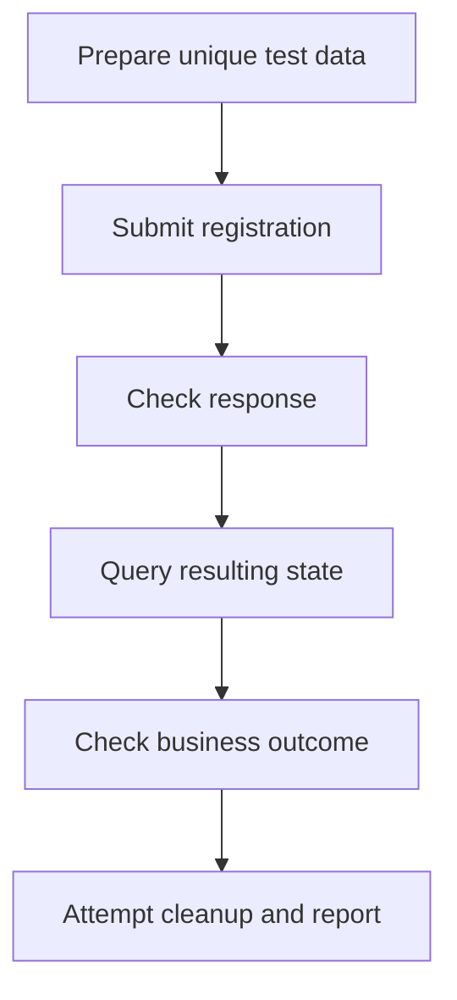

# MVP Use Cases

Project: AI-driven System Testing Service  
MVP target date: 22 November 2026  
Status: Draft

## 1. Purpose

Enable repeatable REST API testing from structured plans, with explicit
assertions, business-outcome verification, and requirement traceability.

AI proposes test plans. Expected behaviour comes from supplied
specifications and requirements.

## 2. MVP Scope

- One configured REST API target per run.
- JSON request and response bodies.
- Manually written and AI-generated structured plans.
- Setup, test steps, follow-up checks, and cleanup.
- JSON reports and a command-line exit code.
- A local demonstration registration API.

Browser testing, embedded systems, dashboards, distributed workers,
and automatic repairs are outside the MVP.

## 3. Actors

| Actor | Responsibility |
|---|---|
| QA engineer or developer | Configure the target, supply requirements, review plans, and inspect results |
| Continuous integration pipeline | Start a run and collect its report |
| AI model provider | Propose structured plans from supplied inputs |

## 4. UC-01 — Execute a Manually Written Test Plan

### Goal

Execute a structured REST API test plan and report whether observed
behaviour matches explicit expectations.

### Rationale

A reliable execution engine is needed before introducing AI generation.

### Requirement references

FR-01 through FR-10.

### Preconditions

- The target API is running in a test environment.
- Its permitted base URL and request timeout are configured.
- A structured test plan is available.
- Expected results are linked to documented requirements.
- Required credentials are available outside the plan.

### Trigger

The user or pipeline requests execution of a plan.

### Main workflow

1. Load the target configuration and plan.
2. Validate the complete plan before contacting the target.
3. Execute setup steps.
4. Execute test requests in order.
5. Capture supported response values for subsequent steps.
6. Evaluate explicit assertions.
7. Attempt cleanup.
8. Save a sanitised JSON report.
9. Return an exit code representing the run outcome.

### Alternative and error flows

| Condition | Expected behaviour |
|---|---|
| Invalid plan | Return validation errors without contacting the target |
| Disallowed destination | Reject the plan before execution |
| Request timeout or connection failure | Record an execution error and attempt cleanup |
| Failed assertion | Record expected and observed values; continue independent checks where possible |
| Missing value needed by a later step | Record the dependency problem; skip affected steps and attempt cleanup |
| Cleanup failure | Preserve earlier results and report cleanup failure |
| Report cannot be saved | Return a clear error and a non-zero exit code |

### Postconditions

- A report is available unless report creation failed.
- Cleanup outcome is recorded.
- Failed assertions, execution errors, or cleanup failures produce
  a non-zero exit code.

### Acceptance criteria

- AC-01: A valid example plan executes against the demonstration API.
- AC-02: An invalid plan sends no requests.
- AC-03: Requests remain within the configured target.
- AC-04: Status and selected JSON value assertions evaluate correctly.
- AC-05: A captured response value can be reused in a later request.
- AC-06: Assertion failures and execution errors remain distinguishable.
- AC-07: Cleanup is attempted after a test failure.
- AC-08: Reports include requirement references and sanitised evidence.
- AC-09: A successful run returns zero; an unsuccessful run returns non-zero.

## 5. UC-02 — Verify Business Outcomes

### Goal

Verify that an API operation produces the required state and side effects.

### Rationale

An expected response status does not prove that stored data is correct.

### Requirement references

FR-04 through FR-09.

### Preconditions

- UC-01 execution capabilities are available.
- The target provides an authorised way to observe the relevant state.
- The plan defines both response and business-outcome assertions.
- Test data can be identified and cleaned up.

### Trigger

A test operation requires verification beyond its immediate response.

### Main workflow

1. Prepare uniquely identifiable test data.
2. Observe relevant initial state where required.
3. Submit the operation under test.
4. Check its response.
5. Query the relevant resulting state.
6. Compare the observed state with the expected business outcome.
7. Attempt cleanup of test data.
8. Include both response and state assertions in the report.

### Example — Reject an underage registration

Business rule DEMO-01: Users must be at least 18.

The demonstration API contract specifies:
- POST /users rejects age 17 with HTTP 422.
- GET /users?email=... returns matching users in an `items` array.

Workflow:

1. Generate a unique test email address.
2. Confirm that no user exists with that email.
3. Submit registration with age 17.
4. Assert that the response status is 422.
5. Query users with that email.
6. Assert that `items` is empty.
7. Attempt cleanup if unexpected test data exists.

### Workflow diagram

### Alternative and error flows

| Condition | Expected behaviour |
|---|---|
| Correct response, incorrect state | Fail the business-outcome assertion |
| State observation unavailable | Record an execution error; do not mark the test passed |
| Operation request times out | Attempt state observation when possible; do not assume the operation had no effect |
| Cleanup fails | Report remaining test data and cleanup failure |

### Acceptance criteria

- AC-10: Age 17 is rejected and no user is created.
- AC-11: Age 18 is accepted and the expected user is observable.
- AC-12: Duplicate email registration is rejected and only one matching user exists.
- AC-13: Missing required fields cause rejection without user creation.
- AC-14: A deliberate defect that saves a rejected registration is detected.
- AC-15: Business-outcome results appear separately from response assertions.

## 6. UC-03 — Generate and Validate a Proposed Test Plan

### Goal

Generate a structured test plan from an API specification and business
requirements.

### Rationale

AI can reduce drafting effort while explicit validation and review keep
plans understandable and executable.

### Requirement references

FR-03, FR-11, and FR-12.

### Preconditions

- A supported API specification is available.
- Business requirements have stable identifiers.
- Supported actions and assertions are defined.
- An AI provider is configured, or example-planner mode is selected.
- Target credentials are excluded from planning inputs.

### Trigger

The user requests a proposed test plan.

### Main workflow

1. Validate the specification and requirement inputs.
2. Provide the planner with the supported plan schema and capabilities.
3. Generate proposed scenarios and synthetic test data.
4. Link scenarios and assertions to supplied requirements.
5. Validate the generated plan.
6. Return the proposed plan and any unresolved expectations.
7. Let the user inspect the plan.
8. Execute only after a separate execution request through UC-01.

### Alternative and error flows

| Condition | Expected behaviour |
|---|---|
| Unsupported specification content | Return a clear limitation or validation error |
| Missing expected behaviour | Flag it as unresolved instead of inventing an expectation |
| Malformed AI output | Return validation errors; do not execute |
| Unsupported action or assertion | Reject the generated plan |
| Unknown requirement reference | Reject the reference and identify the problem |
| AI provider unavailable | Return a generation error |
| Example-planner mode | Return a clearly labelled predefined plan without requiring an AI key |

### Acceptance criteria

- AC-16: A proposal can be generated from the demonstration specification and requirements.
- AC-17: Generated plans follow the supported schema.
- AC-18: Requirement references resolve to supplied requirements.
- AC-19: Unsupported output cannot reach execution.
- AC-20: Missing expectations are explicitly reported.
- AC-21: Generation alone sends no requests to the target.
- AC-22: Credentials are excluded from AI prompts and generated plans.
- AC-23: The example workflow remains usable without an AI API key.

## 7. Demonstration Business Rules

These rules belong to the demonstration API, not the testing service.

| ID | Rule |
|---|---|
| DEMO-01 | Users must be at least 18 |
| DEMO-02 | Email addresses must be unique |
| DEMO-03 | Email and age are required |
| DEMO-04 | Rejected registrations must not create users |

## 8. Traceability to GitHub Issues

| Issue | Main contribution |
|---|---|
| #1 — Define use cases and acceptance criteria | Define UC-01, UC-02, and UC-03 |
| #2 — Design architecture and test-plan format | Design contracts supporting all use cases |
| #3 — Build the demonstration registration API | Provide the target for UC-01 and UC-02 |
| #4 — Implement plan validation and REST execution | Implement UC-01 execution and validation |
| #5 — Add assertions and JSON reporting | Evaluate and report UC-01 and UC-02 |
| #6 — Verify detection of known defects | Verify the runner and business-outcome checks |
| #7 — Integrate AI test-plan generation | Implement UC-03 |
| #8 — Package the example with Docker | Make the complete example reproducible |

## 9. Completion Criteria for Issue #1

- All three use cases include goals and rationale.
- Preconditions, workflows, and error cases are documented.
- Acceptance criteria are measurable.
- Service requirements and demonstration rules are distinguished.
- Use cases reference existing requirements and implementation issues.
- The document is reviewed and merged.